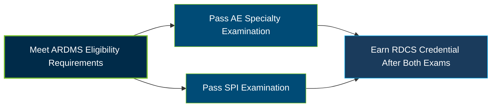

# ARDMS Adult Echocardiography (AE) Certification Exam Guide

A dedicated study guide and clinical reference repository for candidates preparing for the **ARDMS Adult Echocardiography (AE) Specialty Examination**, covering cardiac anatomy, pathology, echocardiographic assessment, and diagnostic imaging.

---

## Exam Overview

The ARDMS Adult Echocardiography (AE) examination evaluates the knowledge and practical skills required to perform and assess adult cardiac ultrasound examinations. It is a qualifying specialty examination for the Registered Diagnostic Cardiac Sonographer (RDCS) credential.

- **Exam Format**: Computer-based examination with multiple-choice and image hotspot questions.
- **Target Audience**: Cardiac sonographers, echocardiography professionals, diagnostic medical sonographers, and eligible healthcare practitioners.
- **Prerequisites**: Applicants must meet one of the ARDMS eligibility pathways, including applicable education, clinical experience, and documentation requirements. A Clinical Verification form is required where applicable. The SPI examination is also required to earn the RDCS credential.

---

## Core Exam Domains & Knowledge Areas

### 1. Anatomy and Physiology

- Normal cardiac anatomy, chambers, great vessels, valves, pericardium, and wall segments.
- Normal systolic and diastolic function, valve function, and left ventricular strain patterns.
- Cardiac cycle phases and normal physiological responses to stress testing.

### 2. Pathology

- Abnormal cardiac physiology, perfusion, ischemic disease, cardiomyopathies, and ventricular dysfunction.
- Valvular disease, pericardial conditions, congenital heart defects, and abnormal great vessels.
- Postoperative evaluation, prosthetic valves, intracardiac devices, and surgical repairs.

### 3. Clinical Care and Safety

- Patient history, clinical assessment, preparation, positioning, and monitoring.
- Recognition and communication of critical echocardiographic findings.
- Universal precautions, equipment cleaning, contraindications, and medical emergencies.

### 4. Measurement Techniques, Maneuvers, and Sonographic Views

- Cardiac valve, chamber, ventricular, vessel, and diastolic function measurements.
- Doppler assessment, pulmonary artery pressure, shunt ratios, and provocative maneuvers.
- Apical, parasternal, subcostal, suprasternal, and transesophageal echocardiographic views.

### 5. Instrumentation, Optimization, and Contrast

- Recognition of imaging artifacts and use of non-imaging transducers.
- Ultrasound console adjustments for optimal imaging and Doppler recordings.
- Transesophageal echocardiography findings and ultrasound enhancing agents.

---

## Certification Path

---

## Recommended Practice & Study Resources

Use current ARDMS examination materials and practical echocardiography learning to strengthen your understanding of the official content domains.

- **CertsGate**: Explore [ARDMS AE Adult Echocardiography preparation resources](https://certsgate.com/exams/ardms/ae-adult-echocardiography) for supplementary study materials and practice questions.
- **Official Practice Tests**: Use [Inteleos Practice Tests](https://www.inteleos.org/resource/practice-tests/) to become familiar with the computer-based testing interface and reinforce examination preparation.
